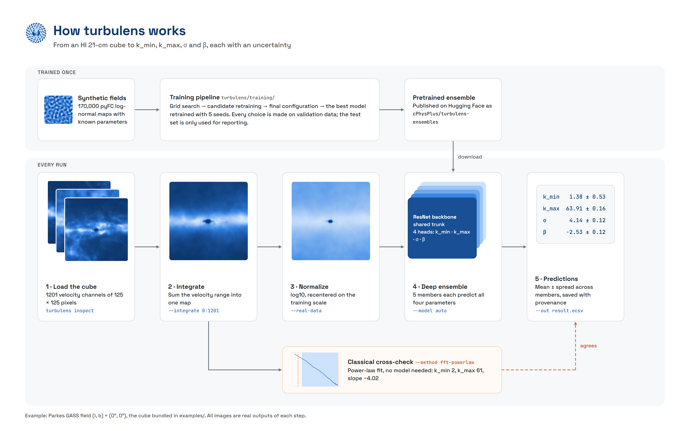
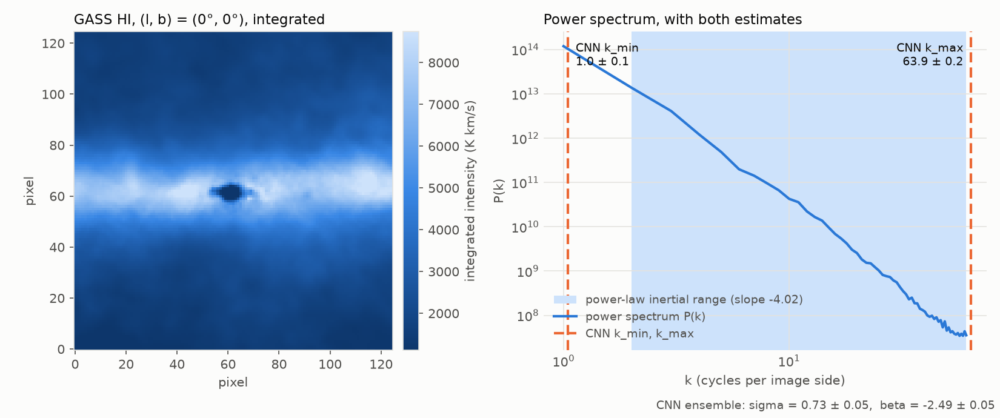

<p align="center">
  <picture>
    <source media="(prefers-color-scheme: dark)" srcset="docs/turbulens/_static/header-dark.svg">
    
  </picture>
</p>

Predicts fractal-turbulence parameters (`k_min`, `k_max`, `sigma`, `beta`) from a radio-astronomy
FITS cube or a synthetic 2D image, using a pretrained deep-ensemble CNN, or classical spectral
estimators that need no trained model at all.

<p align="center">
  
</p>

## Install

Requires Python >= 3.10.

```bash
pip install -e ".[image]"
```

## Try it in three commands

No trained model needed for these — they use a bundled real HI radio observation and a classical
spectral estimator.

**1. Inspect the file** (shape, WCS, velocity range, pixel stats):

```bash
turbulens inspect --input examples/gass_0_0_1774393774.fits.gz
```

```
Data
+----------------------------------------------------------------+
| Source         | examples/gass_0_0_1774393774.fits.gz          |
| Shape          | 1201 x 125 x 125  (channels x height x width) |
| Unit           | K                                             |
| Spectral axis  | VOPT                                          |
| Velocity range | -494.70 to 494.70 km/s                        |
| Rest frequency | -                                             |
+----------------------------------------------------------------+
WCS
+-----------------------------------------+
| Axis | CTYPE    |   CRVAL | Pixel scale |
|------+----------+---------+-------------|
|    1 | GLON-CAR |       0 |        0.08 |
|    2 | GLAT-CAR |       0 |        0.08 |
|    3 | VOPT     | -494700 |       824.5 |
+-----------------------------------------+
Pixel statistics (K)
+-----------------------------------------------+
|    Min |   Max |  Mean |   Std | NaN fraction |
|--------+-------+-------+-------+--------------|
| -11.92 | 148.4 | 3.131 | 12.99 |        0.00% |
+-----------------------------------------------+
```

**2. Integrate the full velocity range into one 2D image and predict `k_min`/`k_max`** with the
classical power-law estimator (appropriate for real data, which has a continuous spectrum rather
than a sharp cutoff):

```bash
turbulens infer --input examples/gass_0_0_1774393774.fits.gz \
    --integrate 0:1201 --method fft-powerlaw
```

```
Predictions
+----------------------------------------------------------------------------+
| Parameter |  Value | +/- (1 std) | Description                             |
|-----------+--------+-------------+-----------------------------------------|
| k_min     |      2 |           - | Lower band edge (cycles per image side) |
| k_max     |     61 |           - | Upper band edge (cycles per image side) |
| alpha     | -4.023 |           - | Fitted power-law slope                  |
| r_squared | 0.9959 |           - | Fit R^2                                 |
+----------------------------------------------------------------------------+
```

**3. Try your own file** the same way — FITS cube, or a plain PNG/TIFF/`.npy` image:

```bash
turbulens inspect --input your_file.fits
turbulens infer --input your_file.fits --integrate LOW:HIGH --method fft-powerlaw
```

### CNN inference (needs a pretrained ensemble)

The classical estimator above needs no model; the CNN ensemble is more accurate but needs one.
`--model auto` downloads the pretrained multitask ensemble from the
[`cPhysPlus/turbulens-ensembles`](https://huggingface.co/cPhysPlus/turbulens-ensembles) Hugging Face
repo on first use and caches it:

```bash
turbulens infer --input examples/gass_0_0_1774393774.fits.gz \
    --integrate 0:1201 --real-data --method cnn --model auto
```

```
Predictions
+---------------------------------------------------------------------------+
| Parameter | Value | +/- (1 std) | Description                             |
|-----------+-------+-------------+-----------------------------------------|
| k_min     |  1.05 |        0.07 | Lower band edge (cycles per image side) |
| k_max     | 63.92 |        0.19 | Upper band edge (cycles per image side) |
| sigma     |  0.73 |        0.05 | Std. dev. of linear density             |
| beta      | -2.49 |        0.05 | Spectral index                          |
+---------------------------------------------------------------------------+
```

On this cube the CNN's band edges and the classical power-law inertial range agree:



(Regenerate with `python docs/turbulens/tools/make_readme_figure.py --out docs/turbulens/_static/gass_example.png`.)

Add `--target {k_min,k_max,sigma,beta}` to use that target's dedicated single-target ensemble
instead, `turbulens download` to fetch ensembles ahead of time (e.g. for offline compute nodes), or
`--output-root <dir>` to use an ensemble you trained yourself (newest version under that root).

`--real-data` is required for real telescope data (divides the map by its mean and log-transforms it, like the unit-mean training fields) — see
`turbulens infer --help` for why, and [`turbulens/README.md`](turbulens/README.md) for the full
quickstart. Full docs (physical background, CLI reference, API) are in
[`docs/turbulens/`](docs/turbulens/index.rst).

## Repository layout

```text
turbulens/            # the package itself -- CLI (`turbulens infer`/`inspect`), inference, models,
                       # io, spectral estimators, and turbulens/training/ (the ensemble training pipeline)
docs/turbulens/        # turbulens' own Sphinx docs (source for the above)
huggingface/           # model card, dataset card, and publish script for the HF releases
                       # (see huggingface/PUBLISHING.md)
examples/              # four real GASS HI cubes to try turbulens on
notebooks/             # the two active notebooks -- see notebooks/NOTEBOOKS.md
data/, outputs/         # local datasets and trained ensemble checkpoints (git-ignored, large)
archive/               # earlier project stages (v0_ ... v4_), the pyFC dataset generator
                       # (data_generation/) and the GASS FITS originals. See archive/README.md.
```

## Training your own ensemble

`turbulens/training/` is a YAML-driven, resumable pipeline that produces the
`<output_root>/<multitask|single_<target>>/<version>/ensemble/members/` layout `turbulens infer
--model auto` expects. See its own README for setup and usage.

## Provenance

This started as a broader research repo (synthetic dataset generation, multiple modeling
frameworks, per-target experiment notebooks) before converging on `turbulens` as the packaged,
production system. That history lives in `archive/`, one folder per stage. Each stage also has a git tag
(`v0-classification` through `v5-turbulens`) marking the last commit where the repo looked like
that stage.
